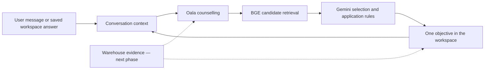

# Phase 1 — prompt and connected conversation foundations

19 September 2026 · Implemented locally, with outstanding quality work listed below.

## Decision

Start with consistent contracts and shared context, then connect a small warehouse pilot. Retain the useful counselling behaviour, the 316 objective prompts and Protocol v1.3. Do not make BGE responsible for counselling, source verification or transaction permission.

The supplied Dropbox v1.7 prompt exactly matched the running repository source. The original is preserved. Version 1.8 is a generated, standalone prompt shared by the Node and Spring resource files. Updating a source module requires regenerating it; the build rejects drift. The Spring application itself has not been exercised in this phase.

## Evaluation of the feedback and current system

| Finding | Evidence in this application | Phase 1 response |
|---|---|---|
| Conflicting service IDs | The old router emitted EDUCATION_RMO, CAREER_PATHWAY_RMO, JOB_RMO and combined apprenticeship/traineeship IDs that the locked response enum rejects. | Central semantic → product → protocol registry; no permissive validator aliases. |
| Graduate work was ambiguous | “Fresh-grad job” is a product label; a structured graduate program is a specific route. | Ordinary graduate work maps to JOB_MATCH_RMO. Only structured programs map to GRAD_PROGRAM_RMO. |
| Readiness could delay requested help | Proactive offers and explicitly requested comparisons inherited the same counselling-understanding gate. | Two paths: readiness controls proactive offers; useful reversible requests can start with enough information. External actions still need scope, a connected implementation and authorisation. |
| Context was fragmented | A new objective used only four user messages, without the preceding question; main chat used only three answers per selected workspace. | Both use a common, versioned context view of persisted contributions, with source/question, correction history and pending-answer status. |
| Two questions competed | Chat and workspace could simultaneously offer independent answer forms. | The visible workspace owns its required question. The latest chat form is deferred; closing it, completing it or processing an answer releases ownership. Safety and service confirmation retain priority. |
| Prompt rules accumulate | The prior runtime combined 137 KB of base instructions with about 49 KB of overlays. | Consolidated standalone version, corrected conflicts and relaxed the mandatory early university framework. A substantial size reduction remains a separate task. |
| Scores describe different things | BGE similarity, service fit, user confidence, counselling understanding and objective readiness coexist. | Documented separate meanings; clicks do not increase confidence. Existing fields remain compatible. No new calibrated satisfaction or readiness score is claimed. |

## What now changes for a user

- A request to compare two named options can receive an immediate comparison without first proving counselling readiness. Missing optional personalisation is not an intake requirement.
- A short answer can travel with the question it answered, rather than being treated as an isolated word.
- New activities can receive relevant answers and corrections from earlier saved activities. Chat also receives saved contributions without a “send result to chat” step.
- Submitted answers remain saved when preparing the result fails. Pending processing does not make the contribution disappear.
- When a workspace asks its question, the latest competing chat question is hidden without discarding the chat form's local state. Closing the workspace restores access to that form if the underlying response contains one.
- “Details I’m using · Edit” can use stored context even when the current result no longer repeats the user’s facts. It stays collapsed by default.

These changes apply to the enabled 316-objective preview. They do not automatically enable it for users who have turned it off. Older saved answers are not regenerated merely by updating the prompt.

## Ownership and data flow

| Owner | Responsibility |
|---|---|
| Main prompt | Helpful explanation, communication, uncertainty, user agency and legal JSON |
| Service registry | Product descriptions, allowed protocol IDs and their distinctions |
| Action bindings | Which external operations actually exist and require confirmation |
| BGE | Candidate retrieval from selection metadata; no tool execution or factual certification |
| Gemini selector and application rules | Choose one useful objective, clarify, or abstain |
| Selected objective | A bounded task using global rules, one prompt and relevant context |
| Shared context | Scoped user contributions, source IDs, questions, timestamps, corrections and pending processing |
| Frontend | Visibility, question ownership, saved-answer history and rendering |
| Warehouse adapter, next phase | Exact entity resolution, filtered retrieval, evidence provenance and freshness |

## Shared context: implemented limits

This is a read model over the existing durable conversation and workspace records, not a new long-term profile database. It retains raw self-reported contributions; it does not infer and silently save semantic facts such as `career_goal` or `skill_level`.

The request view selects at most 16 contributions, caps long contribution values, and flags incomplete context. Selection favours recent messages, relevant words, saved answers and corrections. Full originals remain in their source records. This is an initial bounded recall policy, not proven semantic memory: a differently worded old constraint may still be omitted. A later field-level normalisation/confirmation layer should retain explicit source and supersession links rather than overwrite history.

New activities receive that context; existing activities refresh it on their next answer or correction. The model must still distinguish current, historical, hypothetical and superseded statements. A correction in one activity is not permission to alter an unrelated topic or a reusable profile. Cross-conversation source records are excluded.

## Prompt changes and what is preserved

Version 1.8 corrects the service router, generates its catalogue from one registry, splits the readiness gate, includes connected-context/question-owner instructions and aligns the state description with the existing `activity_context` field. It integrates the three existing runtime additions into the standalone prompt so the file used for external testing matches the Node default. Explicit custom prompt overrides remain supported and continue to receive the existing application additions.

The supplied v1.7 remains unchanged. The response schema remains v1.3; the 316 workbook prompts and BGE model weights are unchanged. The executable action IDs and their disconnected state are preserved. No warehouse access, applications, provider contact or profile writing has been invented.

This is a consolidation and conflict repair, **not a completed prompt compression**. The initial assembled runtime was 185,841 bytes; current v1.8 is 192,528 bytes. Shared-context rules added length despite removing a forced exploration framework. Further shortening should extract duplicated guidance into reusable modules and selectively load examples, with regression tests before replacing the runtime.

## Validation and honest outcome

- Nine new automated regressions cover enum mappings, graduate-job distinctions, rejected aliases, long-conversation recall, question-linked short replies, pending contributions, corrections, question ownership, disclosure rendering and restart persistence.
- Existing 52 objective tests, 35 experience checks, persistence checks, 26 turn-needs scenarios and worker checks, and 10 Oala checks passed.
- Prompt checks preserve the original v1.7 hash, verify both v1.8 resource copies, exercise all 103 legacy skill insertions, retain custom overrides and invalidate stale caches. Type checking and production build passed.
- Sixteen live Gemini requests used eight fictional cases, before and after the wording refinement. All eight final responses passed canonical validation and the targeted routing/interaction checks. No saved personal conversations were sent.
- Raw outputs and usage are under `output/phase1/live/` and `output/phase1/live-revised/`. These are prompt regressions, not 316-tool routing benchmarks or a browser-to-warehouse acceptance test.

**Manual review found remaining quality weaknesses despite automated passes:**

| Final case | Outcome |
|---|---|
| University uncertainty | Correct PATHWAY_RMO and a single question; still overuses a broad landscape and can overstate flexibility. |
| Ordinary graduate job | Correct JOB_MATCH_RMO and no transaction claim; sensible preparation guidance. |
| Structured graduate program | Correct GRAD_PROGRAM_RMO, but still gives unsupported duration/eligibility ranges and bundles discipline with graduation timing. Needs further repair. |
| Low-confidence explicit comparison | Delivers the comparison without a questionnaire; some engineering-versus-marketing contrasts remain too categorical. |
| Visible workspace question | Explains trade-offs without adding another chat question. |
| Saved study-time correction | Uses part-time rather than full-time; still adds unsupported workload/timetable numbers and a compound question. Needs further repair. |
| Unavailable warehouse fee | Does not claim to have fetched data or invent a fee. |
| Social closure | No question or extra activity. |

The full prompt is therefore **not yet production-ready**. The routing/continuity fixes are useful, but prompt wording alone has not eliminated evidence and question-quality failures. A next-step semantic check should cover the interaction question as well as visible prose; the current teaching reviewer primarily edits content blocks. Do not convert these eight cases into a claim of 100% routing accuracy, user satisfaction or production readiness. The earlier 54/100 UX audit is not rescored by these limited tests.

## Warehouse information supplied today

The user supplied `http://localhost:8090` and a Google Drive filesystem folder ending in `01 Databases/RAG`. That folder contains reports and documentation. The later terminal history identified the actual application as `training-gov-db`, which has now been located and started separately from the chat:

- Warehouse application: `/Users/freshfuturesaustralia/My Drive/06 Backend Development/yuzee-monitor/training-gov-db`.
- SQLite database: `/Users/freshfuturesaustralia/.yuzee-monitor/training_gov.db`.
- Warehouse: `http://localhost:8090`; chat: `http://localhost:3000`.
- Warehouse listener now honours `HOST` and defaults to `127.0.0.1`, keeping its existing development authentication bypass local to this computer.
- Chat runtime reports prompt v1.8 with the expected prompt hash. Warehouse health and a course detail request returned HTTP 200. Broad course search exceeded 20 seconds both during startup and on the follow-up check; a subsequent institution-list request also timed out. The course query plan confirms full-table scans and a temporary sort. This must be addressed before using dashboard search as a conversational retrieval backend.

A read-only aggregate check of the current SQLite database found 147,410 live-course rows: 147,409 drafts and one published row. No course row has a non-empty `validated_at` or `canonical_url`; all have a non-empty `intelligence_json` field, which does not prove valid or verified content. There are 4,119 live institutions, none marked published. This describes workflow/provenance fields, not a complete audit of the underlying content. Do not silently publish these records or treat generated intelligence as verified evidence.

The API inventory, field mapping and connection prerequisites are in [Warehouse connection inventory](Warehouse-Connection-Inventory.md). Endpoint verification is saved in `output/phase1/warehouse-verification.json`. **Starting the warehouse does not connect RAG to the chat.** The prompt still correctly reports warehouse access as unavailable until a scoped retrieval adapter is implemented and tested.

The local report `AU_MONGODB_COMPLIANCE_AUDIT_2026_09_07/06_PROVENANCE_AND_EDUCATION_VERIFICATION.md` describes `course_intelligence_db.institution`, `course_intelligence_db.course`, institution identity/provenance fields, and the `course.institutionId → institution._id` relationship. It reports unpopulated verification fields and possible stale registration data as of its own audit date. Those are historical report findings, not a fresh database audit. A stored government status must not be represented as freshly verified.

## Delivery order from here

1. **Finish prompt quality and modular simplification.** Remove overlapping instructions, define one input question precisely, test unknown evidence and unsupported numeric claims, and include the interaction in semantic review. Retain tone and meaningful teaching depth.
2. **Complete the warehouse retrieval contract.** Initial API/schema inventory and startup are complete. Resolve search latency, return publication/hold/validation metadata in a narrow read API, verify entity joins and approve the evidence subset for the pilot. No credentials belong in prompts.
3. **Build one retrieval pilot.** Begin with named course/institution comparisons and supplied constraints. Resolve exact IDs and typed filters; return a small evidence pack with source, date, applicability, unknowns and conflicts. Keep courses separate from offerings/intakes and occupations separate from vacancies/offers.
4. **Connect five representative objectives.** Course comparison, job comparison, skill gap, subject selection and pathway planning. Define required/optional inputs, evidence needs, allowed answers and save semantics before extending all 316 rows.
5. **Calibrate BGE against the final selection metadata.** Evaluate retrieval coverage separately from final selection and automatic opening. Hold out unseen short/long messages, typos, corrections, topic changes, no-tool requests and out-of-domain conversation. Preserve an abstain path.
6. **Run whole-experience acceptance tests.** Chat → selected activity → answer saved → correction → next chat turn → re-open after restart. Include slow/failing APIs, unavailable/stale evidence, accessibility and user testing. Measure helpfulness, burden, completion and actual satisfaction separately.

Release the connected pilot only when it answers from supported evidence, preserves corrections, avoids competing questions and abstains safely. Success is useful, grounded help with less user effort—not more tool openings.
